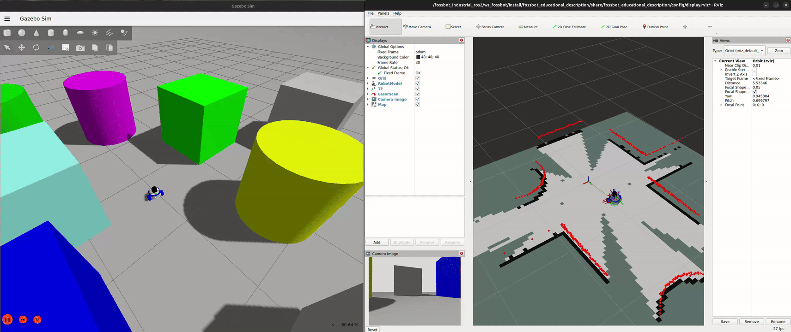

# FossBot Educational Version

- [FossBot Educational Version](#fossbot-educational-version)
  - [Workspace preparation](#workspace-preparation)
    - [Clone the repository](#clone-the-repository)
    - [Docker](#docker)
      - [Build the image](#build-the-image)
      - [Start the container](#start-the-container)
      - [Join a running container](#join-a-running-container)
      - [Build the image for object detection](#build-the-image-for-object-detection)
      - [Start the container for object detection](#start-the-container-for-object-detection)
    - [Native Installation](#native-installation)
      - [Requirements](#requirements)
      - [Installation](#installation)
  - [Quick Start](#quick-start)
    - [Teleop](#teleop)
    - [SLAM Toolbox](#slam-toolbox)
    - [Navigation](#navigation)
  - [Issues](#issues)
  - [Acknowledgements](#acknowledgements)
  - [License](#license)

## Workspace preparation

### Clone the repository

```bash
git clone https://github.com/LRMPUT/FOSSBotEduSim
```

### Docker

You can use the provided Dockerfile to build an image with all the dependencies installed. This is the recommended way to run the simulation, as it ensures that all the dependencies are correctly installed and configured.

The container is configured to use the host's GPU and display, so you can run the simulation with hardware acceleration and visualize it on your screen. 

The [ws_fossbot](ws_fossbot) directory is mounted as a volume in the container, so any changes you make to the code will be reflected in the container (and vice versa).

#### Build the image
```bash
bash build_image.sh
```

>[!NOTE] You can also build the image for object detection (it has additional dependencies for YOLOv11). Check the `Build the image for object detection` section below.

#### Start the container
```bash
bash start_container.sh
```

#### Join a running container
```bash
docker exec -it ros2_fossbot_edu bash
```

#### Build the image for object detection
If you have an NVIDIA GPU run:
```bash
bash build_yolo_image.sh
```

To build the image without GPU support, run:
```bash
bash build_yolo_image.sh --no-gpu
```

#### Start the container for object detection
If you have an NVIDIA GPU run:
```bash
cd object_detection
bash start_container.sh
```

### Native Installation

You can also run the simulation natively on your machine. 


#### Requirements
- ROS2 Jazzy
- Ubuntu 24.04


#### Installation
    
```bash
sudo apt update
sudo apt upgrade

cd fossbot_industrial_ros2
cd ws_fossbot
cd src 
git clone https://github.com/SICKAG/sick_safetyscanners2.git
cd ..
source /opt/ros/jazzy/setup.bash
# Install dependencies
sudo apt-get install ros-jazzy-sick-safetyscanners2 ros-jazzy-sick-safetyscanners2-interfaces
sudo apt-get install ros-jazzy-joint-state-publisher
sudo apt-get install ros-jazzy-sick-safetyscanners-base
sudo apt install ros-jazzy-librealsense2
sudo apt install ros-jazzy-realsense2-description 
sudo apt install ros-jazzy-realsense2-camera
sudo apt install ros-jazzy-ros2-controllers
sudo apt install ros-jazzy-ros2-control
sudo apt install ros-jazzy-navigation2 ros-jazzy-nav2-bringup
sudo apt install ros-jazzy-slam-toolbox
sudo apt install ros-jazzy-teleop-twist-keyboard
sudo apt install ros-jazzy-gazebo-ros-pkgs
sudo apt install ros-jazzy-twist-mux
sudo apt install ros-jazzy-ros-gz ros-jazzy-ros-gz-sim ros-jazzy-ros-gz-bridge

# Build the workspace
colcon build
source install/setup.bash
```

## Quick Start

Run:
```bash
ros2 launch fossbot_educational_description single.launch.py world:=simple_shapes.sdf
```

### Teleop

Control the robot using the keyboard from the terminal

```bash
ros2 run teleop_twist_keyboard teleop_twist_keyboard
```

### Motors and e-stop

`/cmd_vel` behaves like on the real robot with [fossbot-ros2-bridge](https://github.com/LRMPUT/fossbot-ros2-bridge): the last command stays in force until a new one arrives, so send a zero `Twist` to stop. The same services are available:

```bash
ros2 service call /fossbot/estop std_srvs/srv/SetBool "{data: true}"
ros2 service call /fossbot/enable_motors std_srvs/srv/SetBool "{data: false}"
```

Motors start enabled. Add `motors_enabled_on_start:=false` to the launch command to start with them disabled, like the real robot.

### SLAM Toolbox

Build the map using the data from lidar and odometry

```bash
ros2 launch slam_toolbox online_async_launch.py use_sim_time:=True
```

### Navigation

Set the goal pose in map from RViz2

```bash
ros2 launch nav2_bringup navigation_launch.py use_sim_time:=True params_file:=/fossbot_ros2/ws_fossbot/src/fossbot_educational_description/config/nav2_params.yaml
```



## Issues

If you encounter any issues, please report them in the Issues section of the repository.

## Acknowledgements

The original robot meshes and Gazebo description of the robot come from the [FOSSBot](https://fossbot.gr) project. The original hardware designs are in the [fossbot-hardware](https://github.com/chronis10/fossbot-hardware) repository.

The Nav2 behavior tree files in [behavior_trees](ws_fossbot/src/fossbot_educational_navigation/behavior_trees) are based on the defaults that ship with [Nav2](https://github.com/ros-navigation/navigation2), and they remain under the [Apache-2.0 license](ws_fossbot/src/fossbot_educational_navigation/behavior_trees/LICENSE).

The navigation labs use the [Depot](https://fuel.gazebosim.org/1.0/OpenRobotics/models/Depot) model by Open Robotics, which is licensed under [CC BY 4.0](https://creativecommons.org/licenses/by/4.0/). It is downloaded from Gazebo Fuel and is not stored in this repository.

## License

Unless otherwise noted, the code in this repository is released under the [MIT License](LICENSE). Third-party assets (the FOSSBot meshes and robot description, and the Nav2 behavior trees) stay under the terms set by their original authors. See [Acknowledgements](#acknowledgements).
